<picture><source media="(prefers-color-scheme: dark)" srcset="assets/hero-dark.svg"></picture>

<picture><source media="(prefers-color-scheme: dark)" srcset="assets/social-l-dark.svg"></picture><a href="https://www.youtube.com/@CrunchySkyOffical"><picture><source media="(prefers-color-scheme: dark)" srcset="assets/social-1-dark.svg"></picture></a><a href="https://www.tiktok.com/@crunchy.sky"><picture><source media="(prefers-color-scheme: dark)" srcset="assets/social-2-dark.svg"></picture></a><picture><source media="(prefers-color-scheme: dark)" srcset="assets/social-r-dark.svg"></picture>

<picture><source media="(prefers-color-scheme: dark)" srcset="assets/stats-dark.svg"></picture>

<picture><source media="(prefers-color-scheme: dark)" srcset="assets/streak-dark.svg"></picture>

<picture><source media="(prefers-color-scheme: dark)" srcset="assets/wave-dark.svg"></picture>

<a href="https://github.com/cssky-dev/Serpantinum-Infinite-Desktop-Edition"><picture><source media="(prefers-color-scheme: dark)" srcset="assets/project-serpantinum-infinite-desktop-edition-dark.svg"></picture></a>&nbsp;<a href="https://github.com/cssky-dev/Serpantinum-CRK-Moonlight-Theme"><picture><source media="(prefers-color-scheme: dark)" srcset="assets/project-serpantinum-crk-moonlight-theme-dark.svg"></picture></a>

<a href="https://github.com/cssky-dev/Serpantinum-CRK-Whitelily-Theme"><picture><source media="(prefers-color-scheme: dark)" srcset="assets/project-serpantinum-crk-whitelily-theme-dark.svg"></picture></a>

<a href="https://metawka.github.io/expressive-profile/?from=cssky-dev"><picture><source media="(prefers-color-scheme: dark)" srcset="assets/credit-dark.svg"></picture></a>

